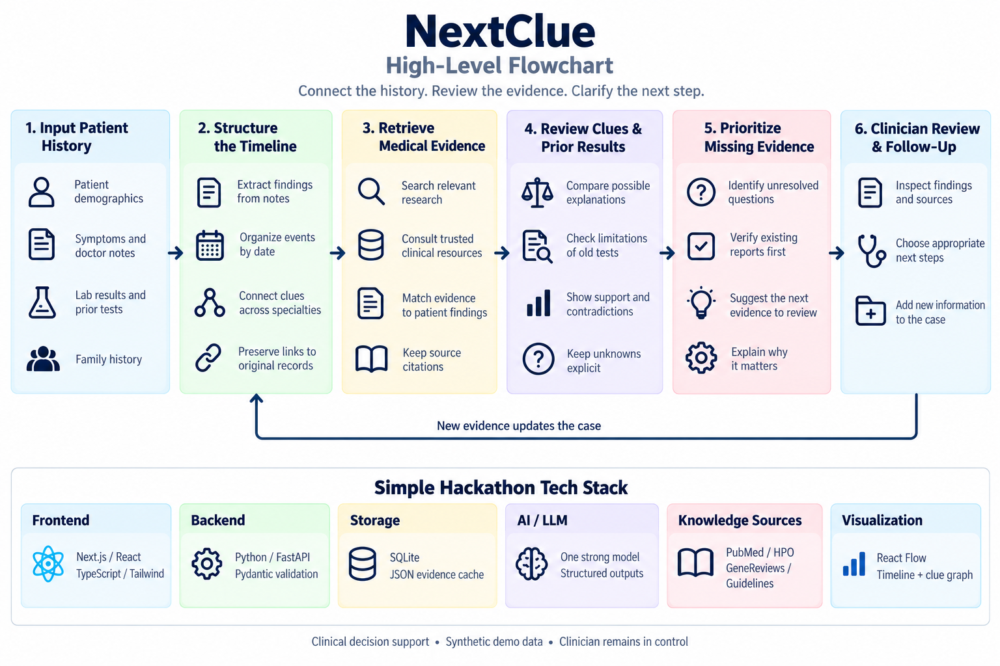

# NextClue

**Connect scattered medical clues. Give the next clinician a clearer starting point.**

**Healthcare & Biotech · H3 — Improving healthcare access and coordination.** Our focus is the handoff between neurology and genetics.

**Status:** backend contracts and Gemini integration are in place; the full demo is in progress.

**Setup:** [Backend + hosted database](backend/README.md) · [AI checks](ai/README.md).

## The idea, simply

A patient may see several doctors for symptoms that seem unrelated. Important findings and old test results can get lost between visits.

NextClue brings that history together and prepares a short, evidence-backed investigation brief: **what happened, what is still unclear, and what the next clinician should review.** Clinicians decide what happens next.

## Our small demo

Use one fictional patient, Sarah, to show three things:

1. A timeline and small graph connecting her medical clues.
2. Original records and medical sources explaining what earlier tests established.
3. A referral-ready brief with unresolved questions and missing reports to check first.

The key moment: an old normal enzyme screen may not settle Sarah's case. NextClue highlights whether a relevant genetic testing report already exists. Her case remains unconfirmed.

## Build requirements

- **Use Kiro meaningfully to build the project.** Commit the real root `.kiro/` folder and briefly document the features used and how they helped. Insufficient Kiro use can disqualify the entry.
- Keep the public repo runnable, with setup instructions and free access for judges.
- Submit a public video **under 3 minutes**, showing the working project; use YouTube or Vimeo.

These are build tasks, not claims of completed work. Use a small Kiro spec and steering guidance; add hooks only when useful.

**Stack:** Next.js, TypeScript, React Flow, FastAPI, Supabase/Postgres, Gemini, and PubMed with cached evidence. Skip real EHR integration, accounts, treatment advice, and extra infrastructure.

## Team and schedule

| Teammate | Ownership |
| --- | --- |
| [Avinash](team/avinash.md) | AI and evidence |
| [Mike](team/mike.md) | Interface and demo |
| [Daniel](team/daniel.md) | Backend and integration |
| [Sean](team/sean.md) | Story, QA, and submission |

**October 24, all times Eastern:** 11:30 AM start → 2:30 PM real AI in the interface → 4 PM complete demo → 5 PM feature freeze → 6 PM start submission → **8 PM hard deadline**. Hacking lasts 8½ hours. After 8 PM, change the submitted version only with organizer approval.

**Clinical decision support only:** synthetic data, visible uncertainty, source links, and clinician review. No claims of clinical validation.

[Event schedule](https://massaicoalition.com/hackachusetts/#day-of-events) · [Official rules](https://docs.google.com/document/d/1aDagPzc29sNGHdycZ-30GMf2z-Np2SwqZX_hY46tLrQ/edit) · [Challenge tracks](https://hackachusetts2026.vercel.app/)

## Run the frontend

```bash
cd frontend && npm install && cp .env.example .env.local
NEXT_PUBLIC_DATA_MODE=offline npm run dev   # bundled Sarah data, no backend
```

Open <http://localhost:3000> (not `127.0.0.1`, because of backend CORS). Data modes, env vars and tests: [frontend/README.md](frontend/README.md).

## How NextClue works


